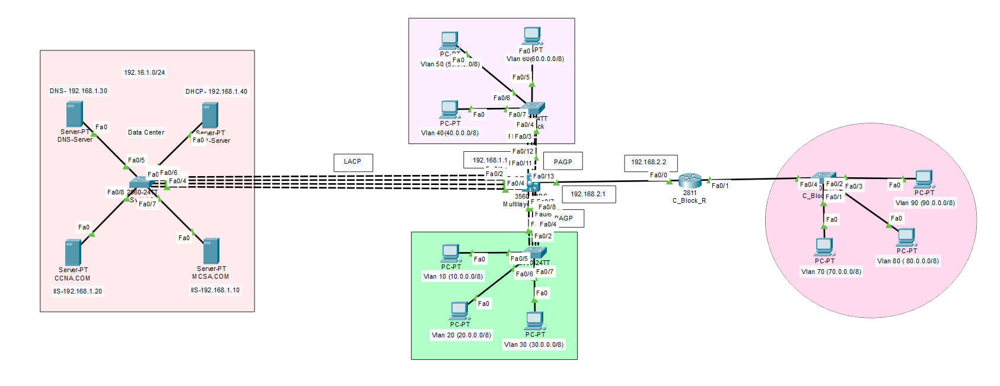

Enterprise Campus Network

Overview

Designed and configured an enterprise campus network using Cisco Packet Tracer.

Technologies Used

- VLAN
- Inter-VLAN Routing
- EtherChannel
- LACP
- PAgP
- DHCP
- DNS
- IIS Web Server

Network Design

The network consists of multiple VLANs, multilayer switching, EtherChannel links, servers and router connectivity.

Verification

- VLAN connectivity
- DHCP address assignment
- EtherChannel configuration
- Web server connectivity
